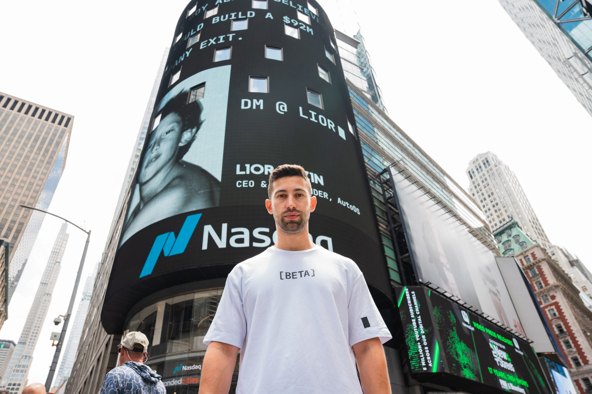

# At 13 I was arrested. At 28 I sold my bootstrapped company to Fiverr for $92 million.

I did not grow up with money. My parents were immigrants from Ukraine. I am 31, and my target is to be a billionaire by 45.

---

**AGE 10 — My father locked my computer. I broke the password.**

That was my first hack, and the first time I understood that a no is not final.

**AGE 13 — I was arrested.**

A fight with another boy. I have never spoken about this anywhere.

**AGE 14 — The school threw me out.**

The same year I made my first $40 selling online. I started earning from e-commerce to buy shoes and a skateboard, things I could not afford.

**AGE 21 — eBay closed the account that paid my bills.**

It was my only income. Seven years of work gone in a morning. I opened 100 stores instead of one, then wrote the software to run them. That software became AutoDS.

**AGE 23 — I became a millionaire.**

All I wanted was to give other people the chance I had to build for myself: earn online, from anywhere, with nobody's permission. 1.8 million people use it now, and more than a billion dollars has been earned through it by people I have never met.

**AGE 26 — I turned down $30 million for the company.**

A private equity firm wanted to buy it. Six months of due diligence, everyone ready to sign. Then I understood the plan: cut the team, squeeze the company for cash. Those people had been with me for years, on salaries below what the market would have paid them. I could not do that to them. I walked away the day before closing.

**AGE 28 — Fiverr bought my company for a reported $92 million.**

23 days from first call to signed, with 200 people on the team. Built with no investors, not one dollar from anyone outside.

> “I waited for the happiness to show up.
>
> The day after, I felt completely empty.”

**AGE 29 — Forbes put me on the 30 Under 30 list.**

(My mother still asks when I am going back to programming.)

That was also when I started paying attention to my own wellbeing. A Tony Robbins conference every year since. A Wim Hof retreat. Ice baths. Training. What I eat.

About 10 hours of my week go into working on myself. Therapy, mentors, gym, learning. It is the first thing most founders cut when the calendar fills up, and the last thing I will ever cut.

**AGE 31 — I am still the CEO, and I am already building the next thing.**

Founder of four products, and Shopify's #1 partner and affiliate. The next one I have not talked about anywhere, and I am ready to talk about it with you.

---

## My core beliefs

### 01. A no is not final.

A life is mostly made of other people's no's. The only decision left is which ones you accept.

> A school said no to me at 14. I was selling online by the end of that year.
>
> eBay said no at 21. I opened 100 stores and wrote the software that became AutoDS.
>
> I said no to $30 million the day before signing, because the plan was to cut my team. Two years later Fiverr paid $92 million.

Every no I was given took me somewhere better. That is my engine.

### 02. Life is a game, and there is no finish line.

The game was the point. Money is how it keeps score. Every level has the same shape: a problem I cannot solve, and a version of me who has to become the person who can.

Treat it like a game. The day it stops being fun, you're playing the wrong one.

### 03. Life is beta.

Nothing I have built has ever been finished, including me. I ship before it is ready and let reality tell me what to fix. Every version of me so far has been replaced by a better one, and this one will be too.

---

## Hear me unscripted

[Real Life Superpowers](https://reallifesuperpowers.com/podcast/lior-pozin-co-founder-ceo-autods/)

---

**Lior Pozin**
Co-founder and CEO, AutoDS, part of Fiverr
[liorpozin.com](https://liorpozin.com)

[ life is beta ]
